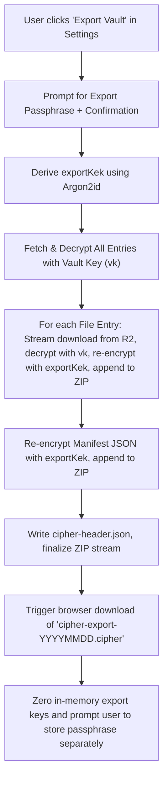
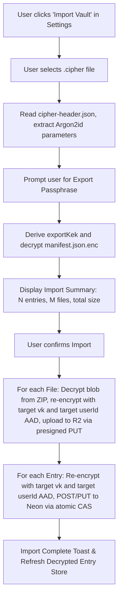

# Phase 6: Encrypted Full-Vault Backup, Export & Disaster Recovery

## Context & Purpose

Phase 5 delivered zero-knowledge file attachments and direct Cloudflare R2 object storage. However, **the vault currently has no disaster recovery or backup path**:
- Neon holds vault configs and encrypted entry metadata.
- Cloudflare R2 holds encrypted file blobs.
- Both systems are separate, and neither has an export/restore mechanism.
- If a database instance is corrupted, or if a user migrates to a fresh deployment, point-in-time database snapshots cannot guarantee synchronization with R2, and cannot restore without the original database state.

**Phase 6 implements complete, portable, zero-knowledge full-vault export and restore.**

> [!IMPORTANT]
> **Scope Boundary:** Phase 6 is strictly scoped to **Encrypted Backup, Export, and Restore**. Vault Key rotation and chunked multi-part streaming for files > 25 MB are post-v1 roadmap items and are explicitly deferred until needed.

---

## 1. The Core Cryptographic Problem: AAD Portability

In Cipher's architecture, every ciphertext in Neon and every blob in Cloudflare R2 is bound with Authenticated Additional Data (AAD):
- **Entry AAD:** `["cipher-entry", cryptoVersion, entryId, userId, type, vaultKeyVersion]`
- **File Blob AAD:** `["cipher-file-blob", cryptoVersion, entryId, userId, r2Key, vaultKeyVersion]`

### Why Raw Database / Storage Snapshots Cannot Restore
If raw database rows and raw R2 blobs were copied to a fresh database or a new account with a different `userId` (or if entry IDs were re-assigned):
- The AES-256-GCM authentication tag verification will fail immediately.
- The ciphertext would be permanently unreadable because `userId`, `entryId`, and `r2Key` are immutable byte inputs to the MAC.

### The Architectural Solution: In-Browser Re-Encryption Under a Dedicated Export Key
1. **Export:** Performed client-side while the source vault is unlocked (when the source Vault Key `vk` is in memory).
   - Each entry and file blob is decrypted in the browser using the source `vk` and verified against its source AAD.
   - The user provides a **Dedicated Export Passphrase** (distinct from their Master Password).
   - An **Export Key** (`exportKek`) is derived using Argon2id with its own fresh 16-byte salt and independent parameters.
   - All entries and file blobs are re-encrypted under `exportKek` using **Portable Export AAD** that contains **NO `userId`** and **NO storage keys**.
   - The package is bundled into a `.cipher` export file.
2. **Import / Restore:** The **only** disaster recovery path.
   - Performed client-side while unlocked inside the target vault (where the target user's `vk` and target `userId` are in memory).
   - The user supplies the `.cipher` file and the export passphrase.
   - The client derives `exportKek`, decrypts and verifies the archive items.
   - Fresh UUIDs are generated for each `entryId`, and fresh R2 keys (`u/<targetUserId>/<uuid>`) are generated for each file blob.
   - Entries and blobs are re-encrypted under the target vault's `vk` bound to the **target `userId`** and fresh IDs.
   - Blobs are uploaded to R2, and entries are committed to Neon via atomic CAS transactions.

---

## 2. Cryptographic Specification

### A. Export Key Derivation (Argon2id)
The Export Key is derived from a dedicated export passphrase using the same hardened Argon2id parameters enforced by `packages/crypto`:

$$\text{exportKek} = \text{Argon2id}(\text{passphrase}, \text{salt}_{\text{export}}, m=65536, t=3, p=1, \text{keyLength}=32)$$

- **Salt:** 16 cryptographically random bytes (`crypto.getRandomValues`).
- **Memory ($m$):** 64 MiB ($65,536\text{ KiB}$).
- **Passes ($t$):** 3 iterations.
- **Parallelism ($p$):** 1 lane.
- **Enforcement:** Governed by `KDF_FLOOR` and `KDF_CEILING` in `packages/crypto`.

### B. Portable Export AAD Schemes
Export ciphertexts never bind `userId`, `r2Key`, or account-specific identifiers:

1. **Export Manifest AAD:**
   $$\text{AAD}_{\text{manifest}} = \text{utf8}(\text{JSON}([\text{"cipher-export-manifest"}, \text{exportFormatVersion}]))$$
   *Example:* `["cipher-export-manifest", 1]`

2. **Export File Blob AAD:**
   $$\text{AAD}_{\text{blob}} = \text{utf8}(\text{JSON}([\text{"cipher-export-blob"}, \text{exportFormatVersion}, \text{blobExportId}]))$$
   *Example:* `["cipher-export-blob", 1, "blob_0001"]`

Every encryption operation uses a fresh, random 12-byte IV (`AES_GCM_IV_BYTES = 12`).

---

## 3. Container Format & Memory Management (250 MiB Vaults)

A user's vault can contain up to 5,000 entries and up to 250 MiB of total file attachments.

> [!CAUTION]
> **Memory Exhaustion (OOM) Prevention:**
> Attempting to assemble a single monolithic 250+ MiB `Uint8Array` in browser JavaScript memory can instantly crash mobile browsers or low-memory devices.
>
> **Hard Requirement:** The export and import processes MUST be streaming and sequential. At no point may the entire vault file archive exist uncompressed in JavaScript heap memory simultaneously. Peak memory is strictly bounded by the size of the single largest file (max 25 MB).

### Container Layout: `.cipher` Archive
The `.cipher` file is a standard ZIP container containing:
1. `cipher-header.json` (Plaintext JSON header):
   ```json
   {
     "format": "cipher-vault-export",
     "version": 1,
     "createdAt": "2026-10-11T16:00:00.000Z",
     "kdf": {
       "algorithm": "argon2id",
       "salt": "<16-byte hex salt>",
       "memoryKiB": 65536,
       "iterations": 3,
       "parallelism": 1
     }
   }
   ```
2. `manifest.json.enc` (AES-256-GCM ciphertext):
   - Encrypted under `exportKek` with $\text{AAD}_{\text{manifest}}$.
   - Plaintext contents:
     ```json
     {
       "exportVersion": 1,
       "entries": [
         {
           "exportId": "entry_0001",
           "type": "password",
           "data": { "title": "GitHub", "username": "alice", "password": "..." },
           "createdAt": "...",
           "updatedAt": "..."
         },
         {
           "exportId": "entry_0002",
           "type": "file",
           "data": { "fileName": "tax_2025.pdf", "mimeType": "application/pdf", "fileSize": 1048576 },
           "blobExportId": "blob_0001",
           "createdAt": "...",
           "updatedAt": "..."
         }
       ]
     }
     ```
3. `blobs/<blobExportId>.enc` (One file per encrypted attachment):
   - Encrypted under `exportKek` with $\text{AAD}_{\text{blob}}$.
   - Ciphertext = original plaintext bytes + 16-byte AES-GCM tag.
   - IV stored in the first 12 bytes of `<blobExportId>.enc` or indexed in manifest.

### Streaming Pipeline
- Uses streaming ZIP writer / reader (`fflate` or `zip.js`).
- Files are downloaded from R2 $\to$ decrypted $\to$ re-encrypted $\to$ written to zip sequentially.
- Memory for each file is discarded before the next file begins.

---

## 4. Workflows

### A. Export Flow


### B. Import / Disaster Recovery Flow


---

## 5. UI & UX Design

1. **Settings Navigation:** New section under `/vault/settings` titled **Backup & Disaster Recovery**.
2. **Export Card:**
   - Explanation: "Creates an encrypted, self-contained backup file of your entire vault, including all passwords, secure notes, and attached files."
   - Passphrase input with zxcvbn strength meter.
   - Prominent security callout:
     > [!WARNING]
     > Store your export passphrase separately from your `.cipher` file (e.g. keep one in a password manager or physical safe, and the backup file on cloud storage). Without this passphrase, your backup file cannot be decrypted by anyone.
   - Export Progress Bar (e.g., "Exporting 4/12 files (35%)...").
3. **Import Card:**
   - File selector accepting `.cipher` (or `.zip`).
   - Passphrase prompt with reveal toggle.
   - Preview step showing item counts before writing to database.
   - Conflict resolution toggle: "Skip duplicates" vs "Import as new copies".

---

## 6. Test Hardening & Acceptance Criteria

### A. The "Hard Case" Disaster Recovery E2E Test
- **Cross-Identity Full Restore**:
  1. Create user `userA@e2e.test`, unlock vault.
  2. Create a password entry and attach a 2 MB text/image file.
  3. Export vault with passphrase `ExportHorseBattery99!`.
  4. Create a completely clean user `userB@e2e.test` in an empty database state.
  5. Import the `.cipher` file into `userB` using `ExportHorseBattery99!`.
  6. Assert password entry is visible and decrypts under `userB`.
  7. Assert file attachment is visible, downloads, and matches original plaintext byte-for-byte under `userB`.

### B. Backfilling & Mutation Testing of Prior Phase Criteria
In addition to the import/export tests, Phase 6 will backfill explicit, isolated E2E tests for every scenario previously identified:
1. **Isolated Stale CAS 409 Rejection:** A dedicated test explicitly submitting `entryVersion: 1` against an entry at version 2, proving the server returns `409 Conflict` and the UI shows version conflict feedback.
2. **Total Ciphertext Quota 413:** Testing PUT and POST rejection when a user reaches 20 MiB of total ciphertext.
3. **Storage Quota & Presign Rate Limit:** Testing rejection on the 11th presign request in a 60-second window (429 status) and when exceeding the 250 MiB storage cap.
4. **Foreign R2 Key Rejection:** Submitting `POST /api/vault/entries` with an `r2Key` belonging to a different user, verifying `403 Forbidden`.
5. **HeadObject Commit Rejection:** Attempting to commit an entry whose declared `blobSize` does not match the actual stored object, verifying `422 Unprocessable Entity`.
6. **No Storage Leakage Check:** Verifying after vault lock that no decrypted plaintext strings, passwords, or filenames exist in `window.localStorage`, `window.sessionStorage`, or IndexedDB.
7. **Clipboard Auto-Clear & Three Feedback States:** Dedicated tests asserting auto-clear after 30s when focused, warning when unfocused, and fallback message when `readText` permission is denied.
8. **Replace-File Safe Delete Order:** Verifying old blob remains untouched until new blob is uploaded and DB commit succeeds.
9. **Cron Cleanup Authentication:** Sending GET to `/api/cron/cleanup-orphaned-files` with invalid/missing token (assert 401) and valid token with constant-time comparison (assert 200).

---

## 7. Deliverables & Execution Plan

1. **Milestone 1 (`packages/crypto`):**
   - Implement `exportKek` derivation, export manifest AAD, and export blob AAD functions.
   - Export package tests verifying round-trip encryption/decryption without `userId`.
2. **Milestone 2 (`apps/web` Archive Engine):**
   - Implement sequential streaming export engine (`lib/vault/export.ts`) and import engine (`lib/vault/import.ts`).
   - Memory management guarantees: chunked sequential processing with maximum 25 MB memory allocation.
3. **Milestone 3 (UI Components):**
   - Build Export Dialog and Import Dialog under `/vault/settings`.
   - Real-time progress indicators for multi-file exports/imports.
4. **Milestone 4 (E2E Test Suite Hardening):**
   - Implement `e2e/vault-backup.spec.ts` testing the User A $\to$ User B disaster recovery test.
   - Implement isolated test specs for CAS 409 conflict, quota 413, foreign key 403, HeadObject 422, and storage sanitization.
5. **Milestone 5 (Verification & Smoke Test):**
   - Run `pnpm turbo build test lint typecheck` and full Playwright suite.
   - Run manual staging smoke test against Cloudflare R2 bucket with CORS and `requestChecksumCalculation: "WHEN_REQUIRED"`.
